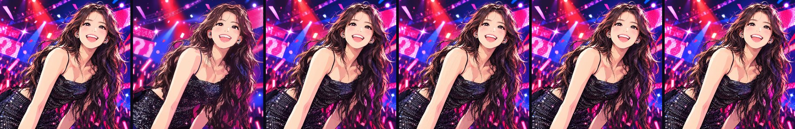

# 코드로 그린 무대

콘서트 무대에서 웃고 있는 인물 일러스트 한 장(`assets/reference.jpg`, 1254×1254)을 다섯 가지 코드 기법으로
다시 그리고, 원본과 얼마나 닮았는지 숫자로 비교하는 페이지입니다. 어떤 기법도 원본 이미지를 화면에 그대로
띄우지 않습니다. 원본 파일은 비교 슬라이더에만 씁니다.



왼쪽부터 원본, 절차적 드로잉, 도형 최적화, 붓질 렌더링, 벡터 트레이싱, 신경망 기억입니다.

## 기법

| 기법 | 원본에서 가져오는 것 | 유사도 | ΔE | 데이터 |
| --- | --- | ---: | ---: | ---: |
| 절차적 드로잉 | 좌표·윤곽선·명암 경계의 모양 (색은 팔레트와 조명 규칙) | 58.9% | 13.1 | 953 KB |
| 도형 최적화 | 도형 5,000개의 위치·크기·색 | 92.6% | 3.5 | 95 KB |
| 붓질 렌더링 | 붓질 101,937개의 경로와 색 | 96.4% | 2.0 | 849 KB |
| 벡터 트레이싱 | 색 영역 약 8만 개의 외곽선과 채우기 | 98.9% | 1.2 | 1.29 MB |
| 신경망 기억 | 특징 격자 138만 칸 + MLP 가중치 | 99.9% | 0.4 | 1.25 MB |

유사도는 두 그림을 314px로 줄여 잰 컬러 SSIM, ΔE는 157px에서 잰 평균 Lab 색차입니다(낮을수록 비슷).
참고로 원본을 가우시안 σ=6으로 흐리면 유사도 67%, σ=16이면 38%입니다.

### 1. 절차적 드로잉 (`js/procedural/`)

사람이 레퍼런스를 보고 다시 그리듯, 모양은 원본에서 재고 색칠은 코드 규칙으로 합니다.
레이어 다섯 개를 한 캔버스에 순서대로 겹칩니다: 무대 → 뒷머리 → 몸 → 얼굴 → 앞머리 → 후처리.

- **무대** (`stage.js`): 조명 영역(방사형 그라디언트) 40여 개, 노이즈 질감을 입힌 원뿔 빔, 원형 점으로 된
  LED 패널과 물음표 글리프, 트러스, 흐린 관객 실루엣, 응원봉, 꽃가루, 별 모양 플레어.
- **얼굴** (`face.js`): 눈꺼풀·속눈썹·홍채·하이라이트, 웃는 입과 이 하나하나, 볼 터치 빗금, 인이어와 귀걸이.
  좌표는 5~9배 확대 격자에서 쟀고, 턱선은 원본 선화의 중심선을 따라갑니다(`tools/proc_face.py`).
- **몸** (`body.js`): 셀 셰이딩 피부, 가장자리 방향과 두 광원으로 정하는 림 라이트, 몸의 곡률을 따라 휘는
  격자에 하나씩 찍은 스팽글(조명 영역 × 노이즈로 밝기와 색을 정함).
- **머리카락** (`hair.js`): 원본의 구조 텐서로 결 방향장을 만들고 Jobard–Lefer 흐름선을 뽑아(`tools/proc_hair.py`)
  다발과 가닥을 그립니다. 빛 받는 면·중간톤·푸른 반사의 모양은 원본 명암 경계에서 잰 윤곽을 결 방향으로
  다듬은 것이고, 어두운 선과 밝은 결의 위치·굵기도 원본의 능선에서 잽니다. 그 모양을 칠하는 색은 세 가지
  색 램프와 조명 영역 규칙이 정하고, 면 가장자리의 가닥 끝, 틈을 가로지르는 가닥, 실루엣 밖으로 말려 나가는
  잔머리는 규칙으로 만듭니다.
- **후처리** (`fx.js`): 블룸, 색 보정, 비네트, 반짝임.

정직하게 밝혀 두면, 이 기법에 들어 있는 원본 정보는 **모양**(좌표, 윤곽선, 결 방향, 명암 경계, 선의 위치와 굵기)과
**팔레트 색 몇십 개**입니다. 원본의 픽셀 값이나 요소별로 뽑은 색은 저장하지 않습니다.
조명 영역과 팔레트는 원본을 보며 정한 상수입니다. 그래서 데이터가 작지 않습니다(기하 데이터 953 KB, 코드 265 KB).
사람이 레퍼런스를 대고 밑그림과 명암 경계를 따는 것에 가깝고, 칠하는 방식이 코드라는 점이 다른 기법과 다릅니다.

재생하면 빔이 무리 지어 밝아졌다 어두워지고, 꽃가루가 날리고, 응원봉과 잔머리가 흔들리고, 스팽글이 반짝이고,
드레스 위로 빛 띠가 지나갑니다. 시각 `t=0`이 원본 구도이고, 같은 시각이면 언제나 같은 그림입니다.
움직이지 않는 부분은 `prepare`/`bake` 단계에서 한 번만 그려 두어 한 프레임에 20~30ms(소프트웨어 렌더 기준)가 듭니다.

### 2. 도형 최적화 (`js/primitives/`, `tools/primitive.c`)

[primitive](https://github.com/fogleman/primitive)처럼 평균색 바탕에서 시작해 오차를 가장 많이 줄이는
반투명 도형을 하나씩 더합니다. 도형마다 후보 2,000개 중 상위 6개를 언덕 오르기로 다듬고, 색은 최소제곱으로
바로 풉니다. 중간중간 이미 놓은 도형도 뒤에 놓인 도형 전체를 고려해 다시 맞춥니다.
줄별 누적합으로 후보 하나를 넓이가 아닌 줄 수에 비례하는 시간에 평가합니다.

### 3. 붓질 렌더링 (`js/strokes/`, `tools/gen_strokes.py`)

Hertzmann(1998)의 다중 크기 곡선 붓질을 바탕으로, 반지름 32px부터 0.75px까지 7단계로 덧칠합니다.
붓질은 원본 결을 따라 휘고, 실제로 칠해 봐서 오차가 줄 때만 남깁니다. 마지막에 붓 방향으로 물감 결을
돋을새김해 유화 질감을 냅니다.

### 4. 벡터 트레이싱 (`js/trace/`, `tools/gen_trace.py`)

픽셀 하나하나에서 시작해 합쳤을 때 오차가 가장 적게 느는 이웃 영역끼리 합치는 C 영역 병합기로 약 8만 영역을
만들고, 영역마다 단색 또는 선형 그라디언트로 채웁니다. 외곽선 꼭짓점을 원본 경계의 50% 지점까지 1/4px
단위로 옮기고, 배경부터 큰 영역 순으로 1px씩 겹쳐 칠해 틈을 없앱니다. 같은 크기의 vtracer 결과보다
더 정확했습니다(유사도 90.4%, 7.7 MB).

### 5. 신경망 기억 (`js/neural/`, `tools/train_neural.py`)

좌표 (x, y)를 넣으면 색을 돌려주는 신경망을 원본에 맞춰 학습시켰습니다. Instant-NGP처럼 해상도가 다른 특징
격자 8장(16²~800², 얼굴 전용 300×250)에서 보간한 특징 24개를 MLP(24→32→32→3)에 넣습니다.
학습은 numpy로 직접 짠 순전파·역전파와 Adam이고, 7~8비트로 양자화한 격자를 WebGL2 셰이더가
픽셀마다 계산합니다. WebGL2가 없으면 JS로 계산합니다.

## 실행

```bash
npm start            # http://localhost:8080/concert/
# 또는 concert/index.html을 브라우저로 바로 열어도 됩니다.
```

주소 옵션: `#trace`처럼 기법 id로 바로 열기, `?m=procedural&raw=1&static=1&t=2.5`는 UI 없이 한 장면만.
절차적 드로잉은 `layers=hair,face`(그 레이어만), `under=ref`(원본 위에 그리기), `onion=0.5`(원본 겹치기)로
레이어 하나씩 살펴볼 수 있습니다.

## 도구

모두 `concert/tools/`에 있고, 같은 입력이면 같은 결과를 냅니다.
Python 도구에는 `numpy pillow opencv-python-headless scikit-image scipy`가 필요하고,
`render.js`에는 Playwright(크로미움)가 필요합니다.

| 파일 | 하는 일 |
| --- | --- |
| `render.js` | 헤드리스 크로미움으로 기법 하나를 1254×1254 PNG로 찍는다 |
| `compare.py` | 원본과 비교한 수치(SSIM, ΔE, 영역별·마스크별)와 나란히 보기 이미지를 만든다 |
| `score.py` | 모든 기법을 찍어 `js/scores.js`와 `assets/lineup.jpg`를 다시 만든다 |
| `analyze.py` | 원본을 피부·머리·드레스·배경으로 나누고 윤곽·좌표·팔레트를 뽑는다 |
| `proc_stage.py` `proc_face.py` `proc_body.py` `proc_hair.py` | 절차적 드로잉 레이어용 기하 측정 |
| `primitive.c` + `gen_primitives.py` | 도형 최적화 (한 코어로 약 6분) |
| `gen_strokes.py` | 붓질 생성 (약 1.5분) |
| `gen_trace.py` | 벡터 트레이싱 (C 컴파일러 필요, 약 2분) |
| `train_neural.py` | 신경망 학습 (2스레드로 약 15분) |

```bash
node concert/tools/render.js --method trace --out /tmp/trace.png
python3 concert/tools/compare.py /tmp/trace.png --out-prefix /tmp/trace --crops face,eyes
python3 concert/tools/score.py
```

## 구조

```
concert/
  index.html, css/style.css     페이지 (셋리스트, 원본 겹쳐 보기, 재생/멈춤)
  js/core.js                    시드 난수, 노이즈, 경로, 스크립트 로더, 기법 레지스트리
  js/methods.js                 기법 목록과 설명
  js/app.js                     화면 조작
  js/scores.js                  score.py가 만든 점수
  js/<기법>/                    기법별 코드와 생성된 데이터
  tools/                        생성기와 측정 도구
  tools/analysis/mask_*.png     영역 마스크 (compare.py가 마스크별 점수에 쓴다)
  assets/reference.jpg          원본
```

데이터 압축을 푸는 데 브라우저 내장 `DecompressionStream`을 쓰므로 Chrome 80, Firefox 113, Safari 16.4 이상이 필요합니다.
